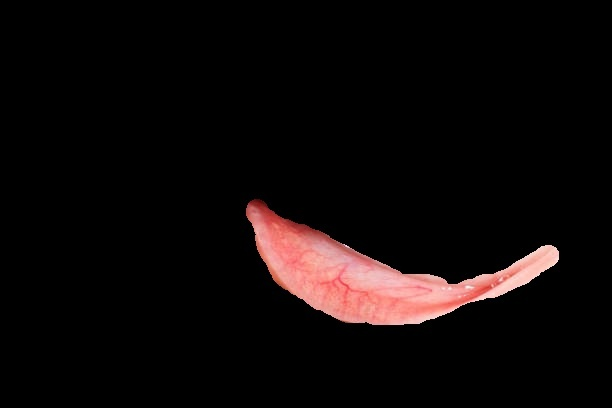

# GUÍA DE USO — Anemia Detection

Esta guía está orientada al cliente final: pasos concretos para usar la página web con imágenes de referencia y una breve explicación de lo que muestra cada imagen.

---

## 1. Acceso a la aplicación

- Inicia el servidor de desarrollo (ver `INSTALLATION.md` si no lo hiciste):

```powershell
.\.venv\Scripts\Activate
python manage.py runserver 0.0.0.0:8000
```

- Abre en el navegador: `http://127.0.0.1:8000/`.
- Si aún no tienes cuenta, regístrate en la pantalla de registro o pide al administrador que te cree un usuario.
- Para acceder al panel administrativo: `http://127.0.0.1:8000/admin/` (necesitas permisos de superusuario).

---

## 2. Guía paso a paso para el usuario (orientada al cliente)

Sigue los pasos a continuación para usar la página web. A continuación de cada paso hay una imagen de referencia y una breve descripción.

1) Entrar a la aplicación

   - Acción: Abre el navegador y ve a `http://127.0.0.1:8000/`. Si no tienes cuenta, pulsa `Registrarse` y completa el formulario.

   - Imagen de referencia:

    

     - Descripción: Pantalla principal con opciones para iniciar sesión o registrarse; acceso rápido al panel de pacientes y análisis.

2) Iniciar sesión

   - Acción: Introduce tu correo/usuario y contraseña, pulsa `Iniciar sesión`.

   - Imagen de referencia:

    

     - Descripción: Formulario de autenticación. Si tienes problemas, usa "¿Olvidaste tu contraseña?".

3) Seleccionar o crear paciente

   - Acción: Ve a `Pacientes` en el menú, busca el paciente existente o pulsa `Nuevo paciente` para agregar uno.

   - Imagen de referencia:

    

     - Descripción: Lista de pacientes. Selecciona un paciente para ver su perfil y registros.

4) Subir imagen para análisis

   - Acción: En el perfil del paciente, pulsa `Añadir imagen` o `Nuevo análisis`, selecciona la foto de la conjuntiva y confirma.

   - Imagen de referencia:

    

     - Descripción: Formulario para subir la imagen, añadir fecha y notas. Asegúrate de que la imagen esté bien iluminada y enfocada.

5) Ejecutar análisis

   - Acción: Pulsa `Analizar` y espera la respuesta; el procesamiento puede tardar unos segundos.

   - Imagen de referencia:

    

     - Descripción: Resultado con diagnóstico, probabilidad y nivel de confianza. También aparece un historial con análisis previos.

6) Revisar resultados y notas

   - Acción: Revisa el diagnóstico y añade notas clínicas si es necesario; descarga el informe si la aplicación lo permite.

   - Imagen de referencia:

    

     - Descripción: Vista detallada del resultado del análisis y la posibilidad de exportar o guardar observaciones.

---

---

## 3. Ejemplo práctico rápido

- Subir una imagen de prueba:
  - Ir a `Pacientes` → seleccionar paciente → `Añadir imagen`.
  - Subir `static/img/analysis/Pac-1001/ejemplo.jpg` o una propia.
  - Ejecutar `Analizar`.

- Comprobar resultado: aparece en `Resultados` con la probabilidad y el diagnóstico.

---

## 4. Uso del detector desde la línea de comandos (para pruebas)

Puedes usar el detector directamente desde Python (útil para pruebas rápidas):

```powershell
python -c "from ml_models.anemia_detector import AnemiaDetector; d=AnemiaDetector('ml_models/best_model.h5'); d.load_model(); print(d.get_model_info())"
```

Para predecir sobre una imagen:

```powershell
python -c "from ml_models.anemia_detector import AnemiaDetector; d=AnemiaDetector('ml_models/best_model.h5'); print(d.predict('static/img/analysis/Pac-1001/imagen.jpg'))"
```

--- 

## 5. Gestión de modelos ML

- Los modelos `.h5` deben estar en `ml_models/` por defecto: `ml_models/best_model.h5`.
- Si cambias la ubicación, actualiza la ruta al instanciar `AnemiaDetector(model_path='...')`.
- Para recargar el modelo sin reiniciar Django, usa el singleton en `ml_models/model_loader.py`.

---

## 6. Panel de administración y gestión de usuarios

- El superusuario puede gestionar usuarios y revisar datos de pacientes desde `/admin/`.
- Para crear un superusuario:

```powershell
python manage.py createsuperuser
```

---

## 7. Interpretación de resultados

- `probability`: probabilidad de que haya anemia; valor cercano a 1 indica mayor probabilidad.
- `threshold` por defecto: `0.5`. Si `probability >= threshold` entonces `has_anemia=True`.
- `confidence_level` devuelve una etiqueta según la probabilidad (Muy alta, Alta, Moderada, Baja).

---

## 8. Buenas prácticas para las imágenes

- Usar imágenes bien iluminadas y enfocadas de la conjuntiva.
- Recortar para que la conjuntiva ocupe la mayor parte del encuadre.
- Formatos soportados: `.jpg`, `.jpeg`, `.png`.

---

## 9. Problemas comunes y soluciones

- Error `FileNotFoundError: ml_models/best_model.h5`: coloca el archivo `.h5` en `ml_models/` o pasa la ruta correcta al detector.
- Predicciones erráticas: revisa calidad de imagen y que el modelo sea el correcto (versión entrenada adecuada).
- Problemas de memoria al cargar TensorFlow: prueba en una máquina con más RAM o usa una versión de TensorFlow optimizada.

---

## 10. Seguridad y privacidad

- No subas imágenes de pacientes sin el consentimiento adecuado.
- En producción, configura `DEBUG=False`, `ALLOWED_HOSTS` y guarda `SECRET_KEY` en variables de entorno seguras.

---

## 11. Contacto y soporte

- Equipo de desarrollo: (añadir correo o contacto del responsable).
- Para issues: usar el sistema de issues del repositorio.

---

## 12. Anexos

- `INSTALLATION.md` para la instalación completa.
- `ml_models/anemia_detector.py` para uso avanzado del detector.


